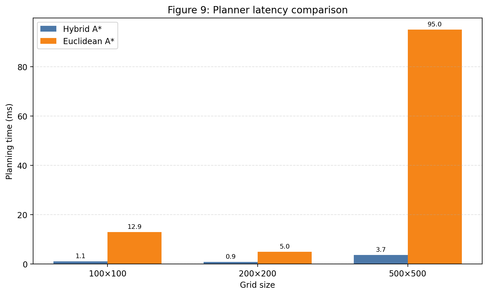
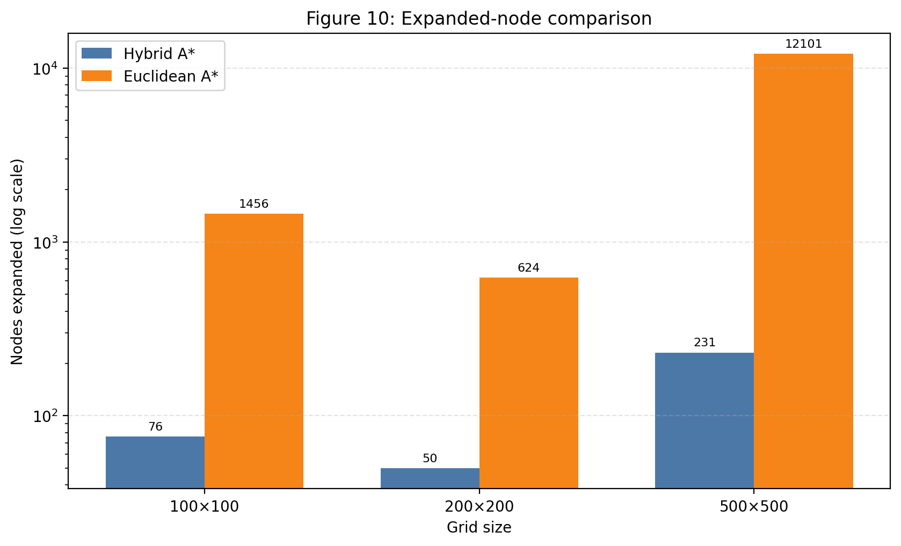
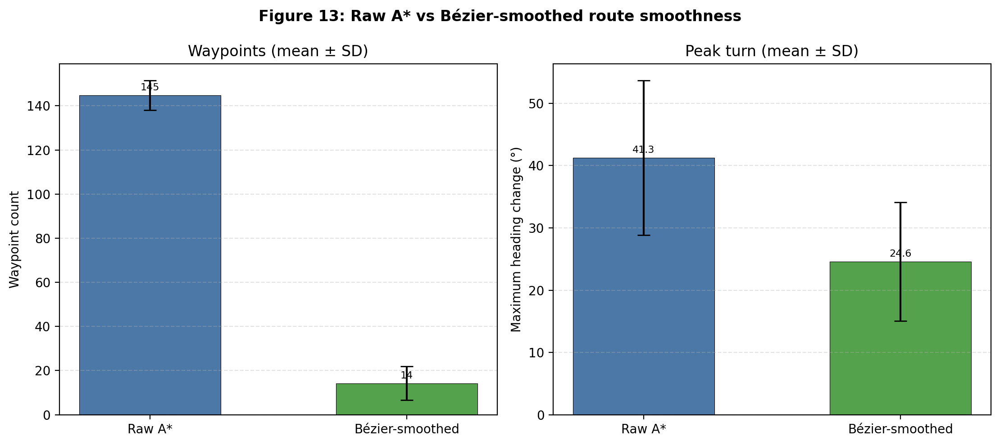

# HARVEST: Agricultural Robot Navigation Research

HARVEST (Hybrid Autonomous Robot for Visual-mapping Enhanced ST-pathfinding) investigates how agricultural visual maps can support efficient, collision-checked robot navigation. This repository presents the research aims, evaluation methods, reported findings and limitations of an MSc dissertation project.

**Research status:** software prototype evaluated with Python benchmarks and Unity simulation. Physical robot deployment has not been validated.

**Release scope:** public research documentation only. The project's Hybrid A* implementation, algorithm equations, pseudocode, tuning logic, source code and other private development material are withheld. This is not an executable software release.

## Research question

Can a pipeline connecting agricultural map interpretation, route planning and simulated execution reduce search effort while preserving near-shortest routes and collision-free behaviour in the evaluated environments?

## Approach

- Convert synthetic field maps and pre-labelled UAV crop/weed masks into occupancy maps, treating soil/background as traversable and crop/weed regions as no-go areas.
- Compare the private research planner against Euclidean A* for computational efficiency and Dijkstra for path-length quality.
- Evaluate route smoothing using waypoint count, peak heading change and collision checks.
- Use Python for map processing and global planning, and Unity for visualisation and simulated route execution.
- Examine how map occupancy and obstacle-clearance margins affect planning and route feasibility.

The dissertation calls the research planner "Hybrid A*". Here that name identifies the project's grid-based planner; it does not imply a demonstrated vehicle-kinematic Hybrid A* implementation with heading and turning-radius constraints.

## Main findings

These are previously recorded dissertation results, not new experiments run for this repository.

- **Largest benchmark (500 x 500):** planning time was 3.7 ms versus 95.0 ms for Euclidean A*, approximately **25.7x faster**. Expanded nodes fell from 12,101 to 231, approximately **98.1% fewer**.
- **Path quality:** mean path-length deviation from Dijkstra was **0.33% across 15 random maps**; the Euclidean A* baseline had 0.00% mean deviation on that test set.
- **Synthetic safety:** raw and accepted smoothed routes passed occupancy-grid collision checks across **seven scenario types**.
- **UAV feasibility:** the separate fixed-configuration evaluation reported **12/12 tiles with a route**, with accepted smoothed routes collision-free against the evaluated grids.
- **Smoothing:** mean waypoint count fell from **145 to 14**; mean peak heading change fell from **41.3 to 24.6 degrees**.
- **Clearance trade-off:** in a separate inflation sensitivity sweep, increasing inflation from zero to three cells increased mean minimum clearance from **2.92 to 10.00 grid cells**, while route success fell from **100% to 25%**.
- **Simulation:** reported Unity validation runs reached the goal with no reported collision or field-exit events. This does not establish real-world safety.

See [evaluation methods](METHODS.md), [results and interpretation](RESULTS.md), and [publication boundaries](PUBLICATION_SCOPE.md).

## Research figures

These original project figures visualise the recorded Python evaluation results. They do not expose the private planner implementation and are not Unity screenshots.

### Planning time

*Dissertation Figure 9. On the 500 x 500 benchmark, recorded planning time was 3.7 ms versus 95.0 ms. These are selected benchmark measurements, not a general runtime guarantee.*

### Search effort

*Dissertation Figure 10. The research planner expanded fewer nodes on all three reported benchmarks. Note the logarithmic vertical axis.*

### Route smoothing

*Dissertation Figure 13. Smoothing reduced mean waypoint count from 145 to 14 and mean peak heading change from 41.3 to 24.6 degrees. The figure labels its error bars as standard deviations; they are not confidence intervals.*

## How Unity was used for validation

Unity tested whether the planned routes could be executed by a simulated robot in a virtual field. Python supplied the processed occupancy map and route; Unity built the environment, displayed the route, and followed the returned waypoints. Unity NavMesh was not used for planning.

- **Classic profile:** a flat farm with procedural obstacles and coverage-route execution.
- **Physical profile:** uneven terrain, configured robot dimensions, collider-backed obstacles and uphill slowdown.
- **WP2 image-map profile:** processed UAV-map traversability colouring and point-to-point navigation through soil lanes.

Validation checked complete map/route responses, goal completion, runtime collisions and field exits. The dissertation reports goal completion with zero reported collision or field-exit events in its validation runs. The simulation used a kinematic route follower with footprint-aware checks; it did not measure physical robot tracking accuracy or prove field safety.

See [the Unity validation workflow and evidence](UNITY_VALIDATION.md) for the process, simulation profiles, checks and limitations.

## Limitations and future research

The evaluation uses a small benchmark set and simulated execution. Timing depends on the recorded test environment and should not be treated as a universal speed guarantee. Pre-labelled masks do not establish perception accuracy under field conditions. Occupancy-grid collision checks are not full continuous-body safety proofs.

Physical field trials, live ROS integration, georeferenced map-to-robot alignment, dynamic obstacles, and planning with explicit robot-footprint and turning constraints remain future work. ROS-compatible exports were demonstrated, but live ROS operation on hardware was not.

## Research provenance

Research by Emad Obeidat, MSc dissertation, School of Computing Sciences, University of East Anglia, 2025/26. Source: *HARVEST: Hybrid Autonomous Robot for Visual-mapping Enhanced ST-pathfinding*, especially evaluation Sections 4.2-4.5 and the conclusion. The original dissertation is intentionally not distributed here because it contains implementation details and personal academic information.

The public summary was checked against the dissertation and available local evaluation summaries. It does not independently reproduce or peer-review the experiments. The dissertation discloses generative-AI assistance during development and states that experimental results were obtained by executing the project software and reviewed by the researcher.

## Availability and rights

Only the documentation in this repository is published. No source-code, dataset, model, patent or private-implementation licence is granted by this release. No open-source licence has been assigned to the withheld software. Third-party research and datasets remain subject to their respective rights.
