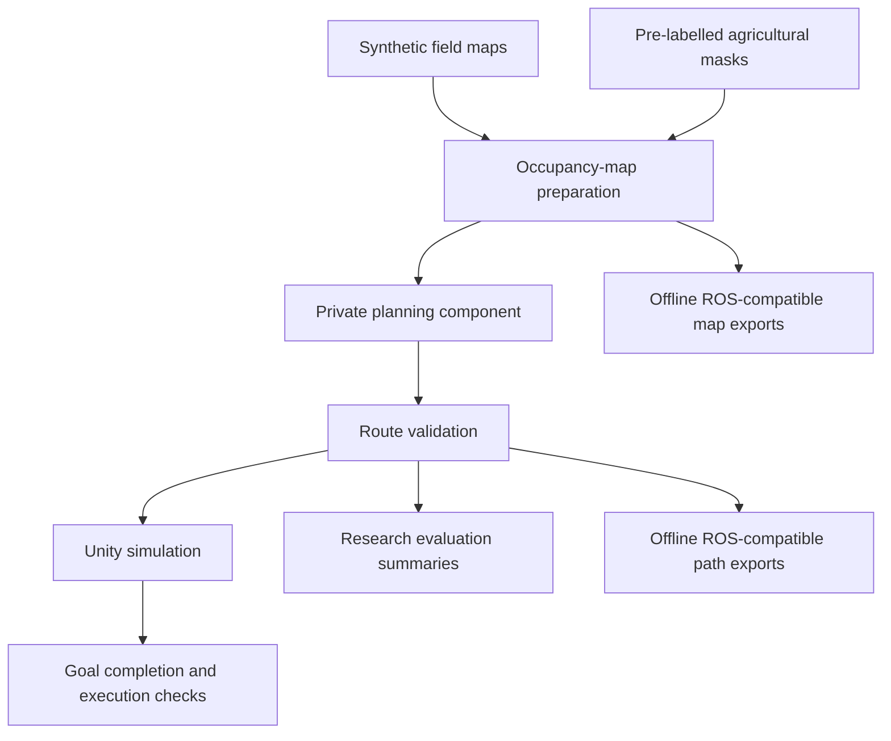

# Research contribution and development roadmap

## What HARVEST contributes

HARVEST brings agricultural map interpretation, route planning and simulated route execution into one evaluated software prototype. Its contribution is the integration and evaluation of this project pipeline; this documentation does not claim invention of occupancy grids, A*, smoothing or other established methods.

### Connecting visual maps to navigation

The project converts synthetic field representations and pre-labelled agricultural segmentation masks into a navigation representation. Soil/background is treated as traversable; crop and weed regions are treated as no-go areas. This provides an explicit connection between visual classes and crop-protective route planning.

### Evaluating efficiency alongside route quality

The evaluation compares computational effort with Euclidean A* and route length with Dijkstra, rather than judging a route only by appearance. The selected benchmarks report substantial reductions in planning time and expanded nodes, with 0.33% mean path-length deviation on 15 random maps. These are observed sample results, not a universal guarantee.

### Investigating trade-offs

Smoothing results quantify changes in waypoint count and peak heading change. Map-density plots show variation in runtime and route length. A separate inflation sweep demonstrates that increasing clearance margins can reduce the number of feasible routes. Together these studies explain why a successful path alone is not enough to evaluate a navigation prototype.

### Testing a complete simulation workflow

A separate Unity client receives map and route outputs, builds the virtual environment and executes the waypoints. The reported checks cover payload completeness, goal completion, collisions and field exits. This establishes a prototype integration result, while leaving real robot tracking and field safety unvalidated.

## High-level system overview

This diagram intentionally describes responsibilities and outputs without exposing planner internals, source structure, equations or tuning settings.

The Unity simulation used the Python connection for execution. The offline ROS-compatible exports are a separate interoperability output, not evidence of a live ROS control loop.

## Evidence available publicly

- [Methods](METHODS.md): evaluation design, metrics and sample sizes.
- [Results](RESULTS.md): measured outcomes, interpretations and known record limitations.
- [Unity validation](UNITY_VALIDATION.md): simulation profiles, execution workflow and reported checks.
- [README figures](README.md#research-figures): selected charts from the recorded evaluation.

The private implementation and raw experimental package are withheld, so the public repository supports inspection of the research account rather than independent reproduction of every experiment.

## Proposed next steps

These are future research directions, not completed features or promised delivery dates.

1. **Strengthen experimental reproducibility.** Record hardware and software versions, repeated-run timing distributions, map provenance and configuration identifiers. Reconcile the separate UAV feasibility and inflation-sweep configurations before treating their success rates as comparable.
2. **Validate on a physical robot.** Measure localisation, path-tracking error, obstacle clearance and goal completion under controlled field conditions, followed by broader terrain and environmental variation.
3. **Improve map-to-world alignment.** Extend the visual input pipeline to georeferenced orthomosaics and verify the transformations between image, map and robot coordinates.
4. **Integrate live robot software.** Move from offline ROS-compatible exports to live exchange of maps, poses and paths, then evaluate integration failures and recovery.
5. **Model vehicle constraints directly.** Incorporate footprint, heading and minimum turning radius into global planning, and evaluate the resulting feasibility and computational trade-offs.

The final four directions follow the dissertation's conclusion; the first is an additional recommendation arising from the reporting limitations documented in this public release.
