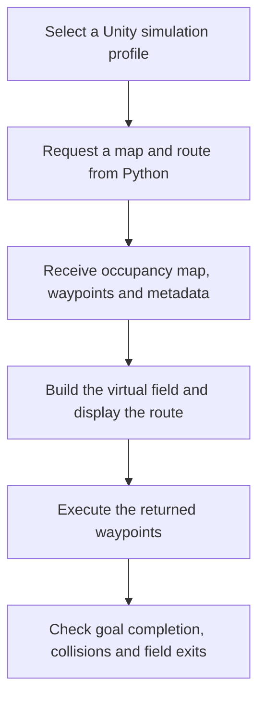

# How Unity was used to validate HARVEST

Unity provided a virtual field in which the robot could execute routes returned by the Python planning system. This tested the connection between map processing, route generation and simulated movement, beyond inspecting a static path plot. Unity NavMesh was not used to generate the research routes.

## Validation workflow

The following diagram summarises the documented workflow; it is not a simulation screenshot.

At the start of a run, Unity requested a scenario or processed image map. The Python backend performed map processing and global planning, then returned the occupancy grid, route waypoints and map information through a TCP/JSON connection. Unity reconstructed the field, placed the robot and displayed the returned route.

The simulated robot followed route segments using a kinematic controller. Footprint-aware obstacle checks and field-boundary handling helped detect or prevent movement into blocked areas. The display included start and goal markers, traversability colouring where appropriate, the executed route and a mower-blade trail. These visual cues supported inspection; completion and collision outcomes provided the reported validation evidence.

## Three simulation profiles

### Classic flat farm

A flat agricultural scene with procedural box obstacles and a top-down view supported coverage-route demonstrations. This profile showed how a returned route could be executed across a farm layout containing obstacles.

### Physical terrain

An uneven-terrain scene used configured robot dimensions, collider-backed obstacles and a follow camera. Ground-height following and mass-based uphill slowdown added terrain-related behaviour. These were simulation approximations, not a calibrated model of traction or full vehicle dynamics.

### WP2 image map

A processed UAV segmentation tile supplied the occupancy map. Unity coloured traversable and non-traversable ground from that map and executed a point-to-point route through the available soil lanes. This connected visual-map interpretation with simulated navigation; it did not validate a live onboard perception system.

## What was checked

1. **Integration:** did Python return a valid, complete response containing the map and route data Unity needed?
2. **Map display:** did Unity construct the environment from the returned occupancy representation?
3. **Route execution:** could the simulated robot follow the returned waypoints and reach the goal?
4. **Obstacle interaction:** were runtime collision events reported during execution?
5. **Field containment:** were field-exit events reported?

The dissertation reports complete map/route payloads, goal completion, and zero reported runtime collision or field-exit events in its Unity validation runs. It does not provide a run count here from which to calculate a statistical reliability rate. These are previously reported outcomes; this repository update did not rerun the simulator.

## What the evidence establishes

Unity supported prototype-level end-to-end validation: the planning output could be passed to a separate simulation client, visualised and executed. The Python benchmarks separately evaluated planner latency, expanded nodes, path quality and occupancy-grid collision checks. The benchmark figures in the README are Python evaluation results, not Unity frame-rate or controller-performance measurements.

The simulation does not establish real-world safety, physical tracking accuracy, localisation robustness, traction performance or minimum-turning-radius feasibility. Physical lateral and heading errors were not measured. ROS-compatible offline exports were available, but these Unity runs used the Python connection rather than a live ROS robot control loop.

## Source and publication boundary

Based on dissertation Sections 3.4.2, 3.4.4, 4.1-4.5 and the conclusion. This description releases high-level research methodology only. Unity scenes, controller source, bridge source, private planner internals and exact tuning settings remain unpublished.
